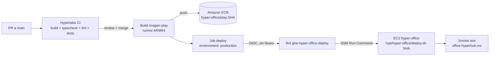
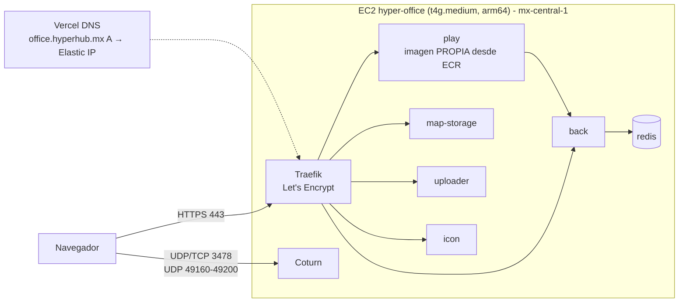

# Hyperlabs Office: deploy y CI/CD en AWS

**Resumen:** se trabaja en ramas y se abre un PR a `main`. La CI corre en el PR, el responsable revisa y mergea, y el merge **se despliega solo** en https://office.hyperhub.mx en unos 10 minutos. Si el deploy falla, se regresa solo a la versión anterior.

---

## 1. Cómo trabajar (para todo el equipo)

```bash
git clone https://github.com/hyperlabs-ai/hyper-office.git
cd hyper-office
git switch main
git switch -c feat/mi-cambio      # una rama por cambio
# ... cambios + commits ...
git push -u origin feat/mi-cambio
```

1. Abre el PR en GitHub.

   > ⚠️ **Este repo es un fork de WorkAdventure.** GitHub propone por defecto mandar el PR al repo original (`workadventure/workadventure`). En la pantalla del PR, cambia **base repository** a **`hyperlabs-ai/hyper-office`** y **base** a **`main`**.

2. La **CI** (`Hyperlabs CI / CI play`) corre sola: build, typecheck, svelte-check, lint, prettier y tests de `play`. Si falla, no se puede mergear.
3. Un responsable revisa y aprueba. `main` pide 1 aprobación.
4. Al mergear corre **`Hyperlabs deploy (AWS)`**. El avance se ve en la pestaña **Actions**, y el resultado en https://office.hyperhub.mx.

**Qué cambios se despliegan solos:**

| Cambias… | ¿Se despliega solo? |
|---|---|
| `play/` (front, pusher, textos, logos, colores), `libs/`, `messages/`, `package*.json`, `patches/` | ✅ Sí: se reconstruye la imagen `play` |
| `docs/`, README, otros archivos | No hace falta: no se construye nada |
| `back/`, `map-storage/`, `uploader/` | ❌ **No.** En producción esos servicios usan las imágenes **oficiales** de WorkAdventure. Para personalizarlos hay que extender el pipeline y construir también esa imagen. |
| `contrib/docker/*`, `deploy/aws/*`, variables del `.env` | ❌ No: se aplican a mano en el servidor (sección 5). |

Antes de hacer push, puedes probar en local con `docker compose up` (ver `README.md`) o correr los checks:

```bash
cd play
npm run typecheck
npm run lint
npm test -- --run
```

---

## 2. Cómo funciona el pipeline



| Pieza | Dónde | Qué hace |
|---|---|---|
| CI | `.github/workflows/hyperlabs-ci.yml` | Corre en cada PR a `main`. Usa los mismos pasos que la CI de `play` de upstream. |
| Deploy | `.github/workflows/hyperlabs-deploy.yml` | Corre en cada push a `main` que toque `play/`, `libs/` o `messages/`. También se puede lanzar a mano desde Actions con **Run workflow**. |
| Build | Runner `ubuntu-24.04-arm` de GitHub | Construye `play/Dockerfile` para arm64, la misma arquitectura que la EC2 Graviton. Gratis en repos públicos. |
| Registro | Amazon ECR `hyper-office/play` (mx-central-1) | Una imagen por commit, etiquetada con el SHA corto. Guarda las últimas 10. |
| Credenciales | OIDC de GitHub → rol IAM `gha-hyper-office-deploy` | **No hay llaves de AWS en GitHub.** El rol solo lo puede asumir la rama `main` o el environment `production` de este repo. Solo puede subir a ese repo de ECR y mandar comandos a esa instancia. |
| Deploy en el servidor | SSM Run Command → `/opt/hyper-office/deploy.sh <sha>` | Hace pull de la imagen, `docker compose up -d play` y espera *healthy*. **Si no queda healthy, regresa al tag anterior** y el job falla. Conserva las últimas 3 imágenes para rollback. Fuente: `deploy/aws/deploy.sh`. |
| Smoke test | Último paso del job | Verifica que `https://office.hyperhub.mx` responda con `<title>Hyperlabs Office</title>`. |

**Tiempos:**
- Build: ~5-10 min.
- Deploy: ~1 min.
- Corte para los usuarios conectados: ~30 s mientras reinicia `play`. Se reconectan solos.

### Rollback manual

Opción 1: en **Actions → Hyperlabs deploy (AWS)**, abre el run de un commit anterior que funcionaba y dale **Re-run all jobs**.

Opción 2, en el servidor:

```bash
sudo /opt/hyper-office/deploy.sh <sha-anterior>
```

Los tags disponibles están en ECR, o en el servidor con `sudo docker images | grep hyper-office/play`.

---

## 3. Infraestructura



| Pieza | Detalle |
|---|---|
| Dominio | `office.hyperhub.mx`: registro **A** en Vercel DNS (equipo *metabrain*) que apunta a la Elastic IP de la EC2. |
| Servidor | EC2 con tag `Name=hyper-office`, **mx-central-1**, Ubuntu 24.04 arm64, 30 GB gp3, swap de 4 GB. Su instance profile `hyper-office-ec2` incluye SSM y lectura de ECR. |
| Firewall | Security Group `hyper-office-sg`: 80/443 abiertos; 3478 tcp+udp y 49160-49200/udp para TURN; 22 solo desde la IP del admin. |
| HTTPS | Traefik + Let's Encrypt. El certificado se renueva solo. |
| `play` | `<ECR>/hyper-office/play:<sha>`: WorkAdventure v1.34.2 + la marca Hyperlabs. |
| `back`, `map-storage`, `uploader` | `thecodingmachine/workadventure-*:v1.34.2`, oficiales. Deben estar en la **misma versión** de WorkAdventure que la base de `main`. |
| `coturn` | En la misma EC2 (host network). Lo usan los usuarios detrás de redes restrictivas. |

**Estructura en el servidor:**

```
/opt/hyper-office/
├── docker-compose.yaml           # copia sin cambios de contrib/docker/docker-compose.prod.yaml (v1.34.2)
├── docker-compose.override.yaml  # = deploy/aws/docker-compose.hyperlabs.yaml (play desde ECR + coturn)
├── deploy.sh                     # = deploy/aws/deploy.sh (lo invoca el pipeline)
└── .env                          # configuración y SECRETOS (chmod 600, nunca va a git)
```

El `.env` (`SECRET_KEY`, el secreto de TURN, las credenciales de map-storage y demás) **solo vive en el servidor.** El repo es público: nunca subas secretos.

**Acceso al servidor:** `ssh -i ~/.ssh/hyper-office-aws ubuntu@office.hyperhub.mx`. Solo funciona desde la IP del admin; para dar acceso a otra persona hay que agregar su IP al Security Group. Las tareas del pipeline no usan SSH.

---

## 4. Modelo de ramas

- **`main`**: producción. WorkAdventure **v1.34.2** (un release estable) + los cambios de Hyperlabs. Es la rama por defecto, está protegida (PR obligatorio, 1 aprobación, CI en verde) y todo lo que entra se despliega.
- **`feat/*`, `fix/*`…**: ramas de trabajo que llegan a `main` por PR.
- **`master`**: espejo heredado de WorkAdventure, sin uso. **No uses el botón "Sync fork"** para traer cambios a `main`, porque traería código de WorkAdventure que todavía no está en un release. Las versiones nuevas entran como se explica en la sección 5.
- Los workflows heredados de WorkAdventure (e2e, desktop, helm, npm…) se borraron de `main`. Solo quedan `hyperlabs-ci.yml` y `hyperlabs-deploy.yml`.

---

## 5. Cambios manuales en el servidor

### Actualizar a una nueva versión de WorkAdventure (~1 vez al mes)

1. Lee el release y sus notas de upgrade en https://github.com/workadventure/workadventure/releases.
2. Haz el merge del tag en una rama:
   ```bash
   git remote add upstream https://github.com/workadventure/workadventure.git   # solo la primera vez
   git fetch upstream --tags
   git switch -c upgrade/vX.Y.Z main
   git merge vX.Y.Z      # resuelve conflictos en los archivos de marca (sección 6), si los hay
   git push -u origin upgrade/vX.Y.Z
   ```
   Si el release reintroduce workflows de WorkAdventure en `.github/workflows/`, bórralos otra vez.
3. Abre el PR → CI → merge → el pipeline despliega el `play` nuevo.
4. **Inmediatamente después**, en el servidor:
   - Compara `contrib/docker/docker-compose.prod.yaml` y `contrib/docker/.env.prod.template` de la nueva versión contra `/opt/hyper-office`.
   - Copia el compose nuevo como `docker-compose.yaml` y agrega al `.env` las variables nuevas.
   - Cambia `VERSION=vX.Y.Z` en el `.env`.
   - Corre `sudo docker compose pull && sudo docker compose up -d`.

### Cambiar configuración (`.env`) o el override

```bash
sudo nano /opt/hyper-office/.env                  # o docker-compose.override.yaml
cd /opt/hyper-office && sudo docker compose up -d   # recrea solo los servicios afectados
```

Si cambias el override, copia el cambio también a `deploy/aws/docker-compose.hyperlabs.yaml` en el repo, para que quede versionado.

---

## 6. Dónde vive la marca en el código

| Qué | Archivo |
|---|---|
| Colores (acento `#383FF2`, superficies `#1C1F30`) | `play/src/front/style/hyperlabs-brand.css` |
| Color de acento en Phaser | `play/src/front/Utils/DesignSystemPhaserColors.ts` |
| Título, nombre de la app, `theme-color` | `play/src/pusher/services/MetaTagsBuilder.ts` |
| Logotipo (login, loader, PWA) | `play/src/front/Components/images/logo.svg` |
| Logos PNG (errores) | `play/src/front/Components/images/logo-min-white.png`, `play/public/static/images/logo.png` |
| Favicons e íconos de la app | `play/public/static/images/favicons/` |
| Textos | `play/src/i18n/es-ES/` y `play/src/i18n/en-US/`. Cambia solo los valores, nunca las llaves. Después corre `npm run typesafe-i18n`. |

Los archivos de imagen conservan los nombres originales de WorkAdventure a propósito, para que los tests existentes sigan pasando.

---

## 7. Configuración inicial (referencia: ya está hecha)

- **AWS** (mx-central-1; CloudShell no existe ahí, se usa el de us-east-1 con `--region mx-central-1`):
  - ECR `hyper-office/play`, con lifecycle que conserva 10 imágenes.
  - IAM OIDC provider `token.actions.githubusercontent.com`.
  - Rol `gha-hyper-office-deploy`:
    - Trust: `repo:hyperlabs-ai/hyper-office:ref:refs/heads/main` y `repo:hyperlabs-ai/hyper-office:environment:production`.
    - Permisos: push a ese repo de ECR, `ssm:SendCommand` sobre la instancia y `AWS-RunShellScript`, `ssm:GetCommandInvocation`, `ec2:DescribeInstances`.
  - Instance profile `hyper-office-ec2` con `AmazonSSMManagedInstanceCore` y `AmazonEC2ContainerRegistryReadOnly`, asociado a la EC2.
- **Servidor:** `amazon-ecr-credential-helper` instalado y configurado en `/root/.docker/config.json`; `deploy.sh`; override con `image: ${PLAY_IMAGE}:${PLAY_IMAGE_TAG}`; `PLAY_IMAGE` en el `.env`.
- **GitHub:**
  - Actions activadas (en los forks vienen apagadas).
  - Variable de repo `AWS_DEPLOY_ROLE_ARN`.
  - Environment `production`.
  - `main` como rama por defecto, con branch protection.
